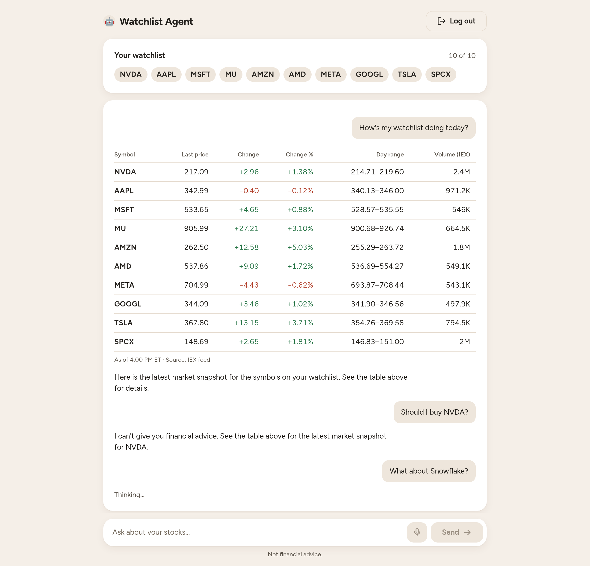

# Watchlist Agent

A small stock watchlist you talk to. Keep up to 10 US stocks or ETFs, then ask
about them in plain words. An LLM (Llama 3.3 on Workers AI) runs a tool-calling
loop against Alpaca's market data to manage the list and answer.

**The model never supplies the numbers.** Every price, change and percentage on
screen comes straight from the market data tools and is rendered as a table.
The assistant's own text is checked for digits, and it is re-prompted if it
tries to state a figure. It also never gives financial advice.

Live at [watchlist.fetchlogic.com](https://watchlist.fetchlogic.com). It is an
internal proof of concept.



<sub>The screenshot replays real IEX snapshots and the model's actual replies
from 2026-10-19, after market close.</sub>

## Things to say

- "How's my watchlist doing today?"
- "Add Cloudflare and Snowflake." (names are fine; the assistant maps them to
  tickers)
- "Remove Tesla."
- "What's on my list?"
- "What about Datadog?" (a symbol that isn't on your list: you get its numbers
  and an offer to add it, valid for your next message only)
- "Yes please." (accepts that offer)
- "Which of my stocks are down today?"
- "How did AMD do over the past month?" (price history)
- "Any news on Cloudflare?" (headlines, labelled positive, negative or neutral)
- The microphone button: speak a question, check the transcript, then send it
- "Should I buy NVDA?" (it will politely decline)

New sessions can start with **QQQ's top 10** holdings in one click. The
watchlist is capped at 10 symbols. If it's full, the assistant offers to swap
one out.

## How it works

- **Frontend:** vanilla TypeScript built with Vite. It has no framework.
- **Backend:** a Cloudflare Worker.
  - **Durable Object:** one per session, keyed by an HTTP-only cookie. It holds
    the watchlist, the last 10 exchanges of conversation (as context for the
    model) and any pending "add this?" offer. Chat turns run inside it one at a
    time.
  - **Agent loop:** Llama 3.3 70B on Workers AI with seven tools:
    `list_watchlist`, `add_symbols`, `remove_symbols`, `get_snapshots`,
    `get_price_history`, `get_news` and `respond`. A turn is capped at 5 model calls. The answer streams to the
    browser as server-sent events.
- **Market data:** Alpaca's free tier. Snapshots come from the **IEX feed
  only**, so volume is a fraction of the whole market, and outside market hours
  the numbers are the last trade.
- **Landing gate:** a disclaimer plus Cloudflare Turnstile. No cookie is set
  until both pass. Logging out deletes everything.
- **Browser history:** the browser keeps a longer display history in
  localStorage and marks where the assistant's memory ends.

More detail:

- [`docs/spec.md`](docs/spec.md): behaviour.
- [`docs/punchlist.md`](docs/punchlist.md): progress.
- [`PRODUCT.md`](PRODUCT.md): product context.
- [`DESIGN.md`](DESIGN.md): the visual system.

## Running locally

You need Node 26 (see `.nvmrc`), a Cloudflare account, and an Alpaca account
(paper trading is fine).

```sh
npm ci
cp .dev.vars.example .dev.vars   # fill in the three secrets
npx wrangler login               # Workers AI runs remotely, even in dev
npm run dev                      # http://localhost:5173
```

`.dev.vars` needs:

- `ALPACA_API_KEY` and `ALPACA_SECRET_KEY`, from the Alpaca dashboard.
- `TURNSTILE_SECRET_KEY`, the secret for the Turnstile widget. The widget must
  allow `localhost`.

Chatting in dev calls the real Workers AI and spends neurons from your daily
allocation. A typical question uses two or three model calls.

## Scripts

| Script                 | What it does                                                                     |
|------------------------|----------------------------------------------------------------------------------|
| `npm run dev`          | Vite dev server running the Worker, Durable Object and frontend                  |
| `npm test`             | All tests, offline (Workers runtime for the server, happy-dom for UI)            |
| `npm run typecheck`    | TypeScript project build check                                                   |
| `npm run lint`         | Biome lint and format check (`npm run format` fixes)                             |
| `npm run types`        | Regenerate `worker-configuration.d.ts` after changing `wrangler.jsonc`           |
| `npm run check:alpaca` | Manual check against the real Alpaca API using `.dev.vars` (never prints keys)   |
| `npm run check:agent`  | Manual agent behaviour checks against the real model and Alpaca (spends neurons) |
| `npm run check:voice`  | Manual transcription check: MeloTTS speech through the app's Whisper call        |
| `npm run build`        | Production build                                                                 |
| `npm run deploy`       | Build and deploy, stamping the current commit                                    |

Tests never touch the network or real secrets. Fake secrets are injected, and AI
and Alpaca are faked. Checks against real services are the manual `check:*`
scripts. The model's output varies, so a failing `check:agent` case is a reason
to look, not proof of a bug.

## Deploying

Pushing to `main` deploys. GitHub Actions runs the types check, lint,
typecheck, tests and build, then deploys. It then polls `/api/health` until
production reports the pushed commit:

```sh
curl https://watchlist.fetchlogic.com/api/health
# {"ok":true,"commit":"<sha>"}
```

Production secrets are set with `npx wrangler secret put <NAME>`.

## Status

Done:

- Sessions and the landing gate
- The watchlist and its starter list
- The Alpaca client
- The agent loop
- Streaming chat
- Price history and news
- The per-session rate limit
- Voice input
- The design system, with light and dark themes

Still to do:

- Tuning the assistant's replies (see the punchlist)
